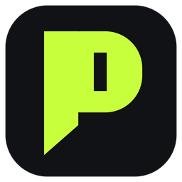
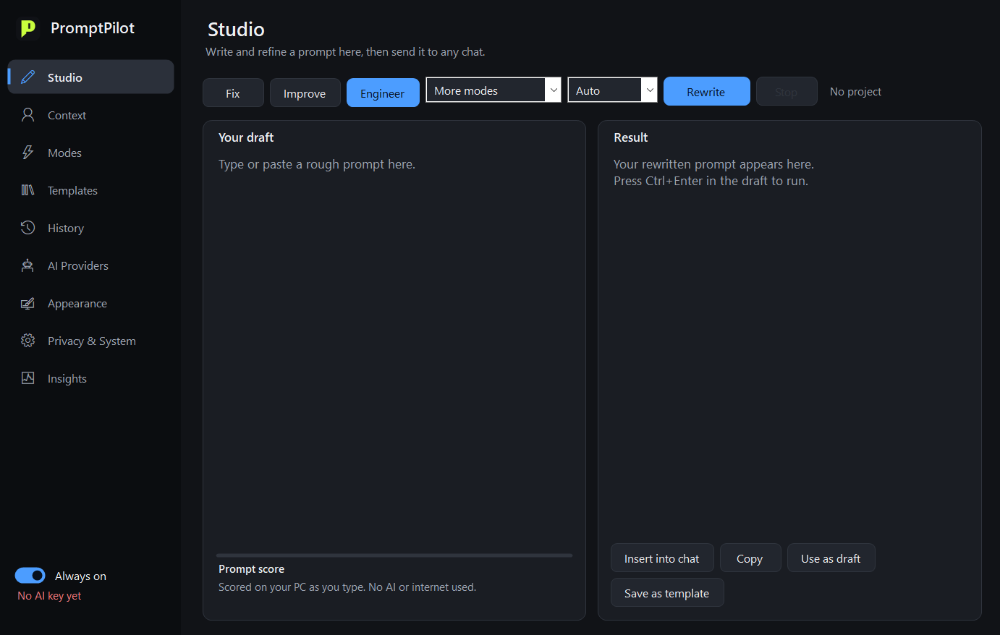
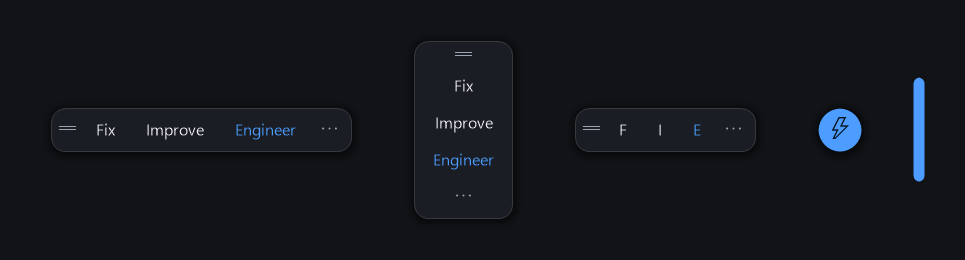
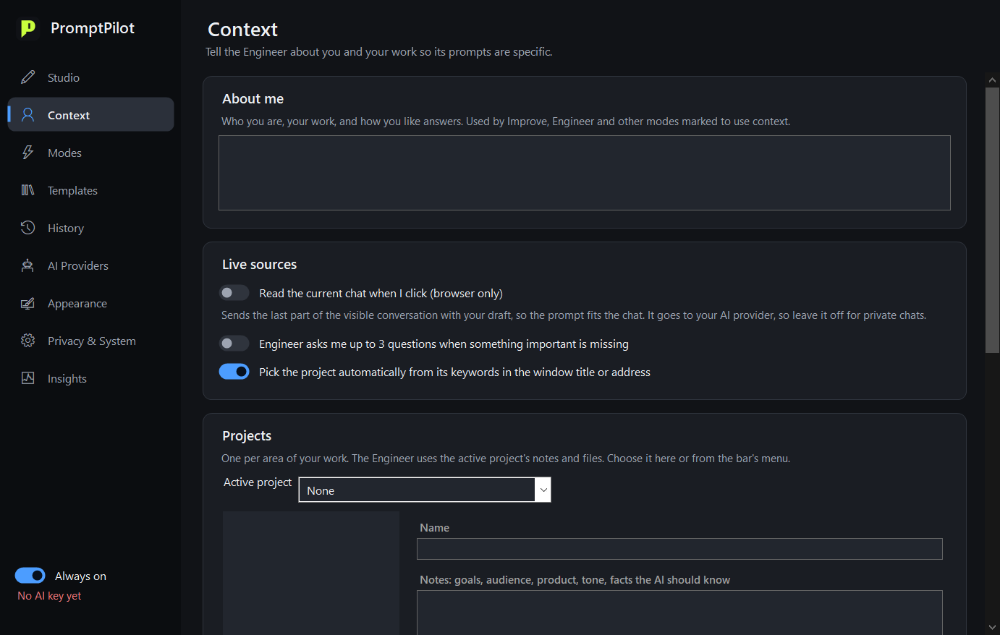
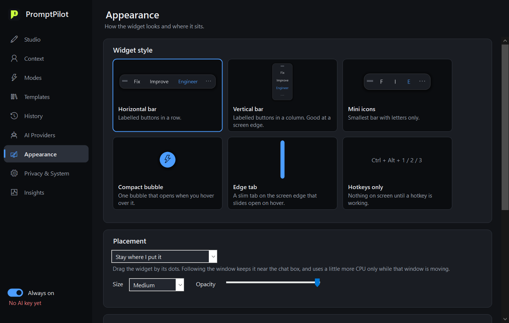

<p align="center">
  
</p>

<h1 align="center">PromptPilot</h1>

<p align="center">
  <strong>Rewrite your prompt right inside ChatGPT, Claude or Gemini, with one click.</strong><br>
  Free, open source and light on your battery. For Windows 10 and 11.
</p>

<p align="center">
  <a href="https://github.com/navasshereef1/PromptPilot/releases/latest"></a>
  <a href="LICENSE"></a>
  <a href="https://buymeacoffee.com/navas1"></a>
</p>

<p align="center"></p>

## What it does

Type a rough prompt in any AI chat. A small bar appears. Click once, and your text is replaced in the chat box.

| Button | Hotkey | What happens |
|---|---|---|
| **Fix** | `Ctrl+Alt+1` | Corrects spelling and grammar only |
| **Improve** | `Ctrl+Alt+2` | Makes it clearer and more specific, in your voice |
| **Engineer** | `Ctrl+Alt+3` | Works out the real goal and builds a full, structured prompt |
| **Undo** | `Ctrl+Alt+Z` | Puts your original text back |

## Quick start

**Install in PowerShell (recommended).** It installs for your account only, needs no admin rights, and checks the download's checksum. [Read the script](install.ps1) first if you like.

```powershell
irm https://raw.githubusercontent.com/navasshereef1/PromptPilot/main/install.ps1 | iex
```

**Or download it.** Get `PromptPilot.exe` from the [latest release](https://github.com/navasshereef1/PromptPilot/releases/latest) and run it. See [Why Windows may warn you](#why-windows-may-warn-you).

**Then:**

1. On the **AI Providers** page, get a free key and paste it in. [Groq](https://console.groq.com/keys) is a good first choice.
2. Open an AI chat, type something, and click **Improve**.

PromptPilot adds itself to the Start menu and to Settings > Apps, and lives in your system tray.

## Features

**Rewriting**
- 18 editable modes, including Critic, Pushback, Cost saver and Reverse prompt, plus any you write yourself
- Five image prompt modes: general, photoreal, Midjourney, FLUX and image edit
- Rewrite only the selected text, or Shift+click to preview the changes first
- A library of templates with blanks to fill in (`Ctrl+Alt+T`)
- Instant prompt score that works offline

**Context, so prompts are about your work**
- *About me* and per-project notes and files
- Projects picked automatically from keywords in the window title
- Optional: reads the current chat (in browsers), attaches the clipboard, or asks you questions first
- Shapes prompts for Claude, ChatGPT or Gemini automatically
- A button that shows exactly what would be sent

**Free AI, with no single point of failure**
- Works with Groq, Cerebras, Gemini, OpenRouter, Mistral and local Ollama
- If a provider fails or hits its limit, the next one takes over
- If a provider is slow, the next one starts too, and the first reply wins

**Light on your PC**
- No background polling: Windows tells the app when something changes
- About 0 CPU when idle, and a few MB of active memory, measured on a Windows 10 laptop
- Starts in about 0.2 seconds
- A single small `.exe` using .NET Framework, which is already part of Windows

<p align="center"></p>

Choose a horizontal bar, vertical bar, mini icons, compact bubble, edge tab, or hotkeys only.

<table>
  <tr>
    <td></td>
    <td></td>
  </tr>
</table>

## Other hotkeys

| Hotkey | What it does |
|---|---|
| `Ctrl+Alt+B` | Turn the bar on or off |
| `Ctrl+Alt+P` | Open PromptPilot |
| `Ctrl+Alt+T` | Open Templates |

All of them can be changed in the app.

## Privacy

There's no account, server or analytics. Nothing is sent until you click, and then only to the AI provider you chose. Keystrokes are never monitored.

- API keys are encrypted for your Windows account.
- Emails, phone numbers, API keys, passwords, card, PAN and Aadhaar numbers are hidden from the AI and restored in the result. Names and addresses are not.
- History is stored in plain text on your PC. You can turn it off.
- Free tiers have their own terms. Some providers, including Google's free Gemini tier, may use your prompts to improve their products.

Read the full [privacy notes](PRIVACY.md).

## How it works

It uses no browser extension. When you click, PromptPilot copies the text from the focused box, sends it to your AI provider, checks that your text hasn't changed, and pastes the result. Your clipboard is put back afterwards. If you edited the text or switched window while it was working, your text is left alone and the result goes to your clipboard.

The modes aren't trained models. Each is a written instruction you can read and edit on the **Modes** page. The ones here are based on [this review of what the evidence says](docs/TECHNIQUES.md), including which popular tricks don't work.

## Why Windows may warn you

SmartScreen warns about downloaded apps that have no paid code-signing certificate or download history yet. If you see it, choose **More info > Run anyway**. Some antivirus tools may also question the app, because it presses keys and uses the clipboard, which is how it replaces your text. [Report a false alarm](https://github.com/navasshereef1/PromptPilot/issues) if you get one.

You don't have to take this on trust:

- All the source code is public, and you can build it yourself with `build.bat`.
- Releases are built by GitHub from that source, with a public record you can verify: `gh attestation verify PromptPilot.exe --repo navasshereef1/PromptPilot`
- Each release lists its SHA-256 checksum.

See the [code signing policy](docs/CODE_SIGNING.md).

## Known limits

- Windows only.
- In the Claude and ChatGPT desktop apps, click in the chat box first, because the app can't confirm a text box is focused there. Reading the current chat works in browsers only.
- Free AI models sometimes guess details. Use Undo, or Shift+click to preview first.
- Providers retire models. If one stops working, use **Load models** on the AI Providers page.

## Build from source

No install is needed. The compiler comes with Windows.

```bat
git clone https://github.com/navasshereef1/PromptPilot.git
cd PromptPilot
build.bat
```

Run the self-checks with:

```bat
PromptPilot.exe --data %TEMP%\pp-test --selftest %TEMP%\pp-result.txt
```

See [CONTRIBUTING.md](CONTRIBUTING.md) to help out.

## Support the project

PromptPilot is free and always will be. If it saves you time, you can [buy me a coffee](https://buymeacoffee.com/navas1).

<a href="https://buymeacoffee.com/navas1"></a>

## Licence

[MIT](LICENSE) © 2026 Navas Shereef. PromptPilot isn't affiliated with OpenAI, Anthropic, Google or any AI provider. It isn't related to the App Store app called Prompt Pilot.
